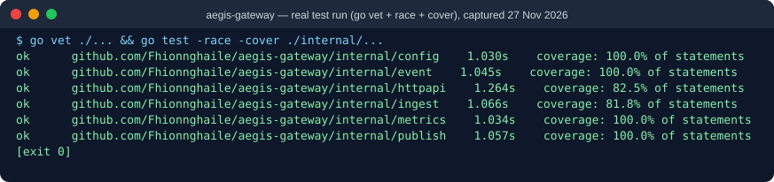

# Aegis Gateway (Go) — manual

*One page, eight blocks. Every figure here comes from this repository's own tests and README.*

## 1. Claim
When its bounded queue is full, the gateway returns 429 and sheds load instead of running out of memory. On SIGTERM it drains to the sink without losing accepted events.

## 2. What it is
This is the front door of the Aegis detection pipeline. It receives security events over HTTP, validates them, queues them and publishes them to Kafka. Under a flood it slows senders down instead of falling over.

## 3. Demo
Capture to record: `go test ./... -race` passing, then the k6 load test with the Grafana 429 panel (`docker compose up --build` and `k6 run loadtest/k6-ingest.js`).


*Real output from this repository's own tests, captured 21 Nov 2026.*

## 4. Run it yourself
**Prerequisites:** Go. Docker and k6 for the full-stack load test.

```bash
go test ./... -race
go test -bench=IngestHTTP ./...
docker compose up --build
k6 run loadtest/k6-ingest.js
```

## 5. What you will see
Unit and race tests pass. The benchmark reports events per second through the validate-and-enqueue path (the README records about 240,000/s in-process on 2 vCPU). Under k6, 429s rise while memory stays flat; metrics are at `http://localhost:8080/metrics`.

## 6. 30-second talking point
> A detection pipeline is blind exactly when it is flooded. The gateway's bounded queue answers 429 the moment it is full, so it sheds load rather than dying, and on shutdown it drains every accepted event before exiting.

## 7. Scope and limits
- Single-node reference. Horizontal scale-out is a deployment concern.
- The in-process figure is hardware-dependent. Re-measure end to end with `loadtest/` on your target.

## 8. Links
[Repository](https://github.com/fhionnghaile/aegis-gateway) · [Write-up](https://padraigfhionnghaile.com/work/aegis-gateway/) · [README](README.md)
